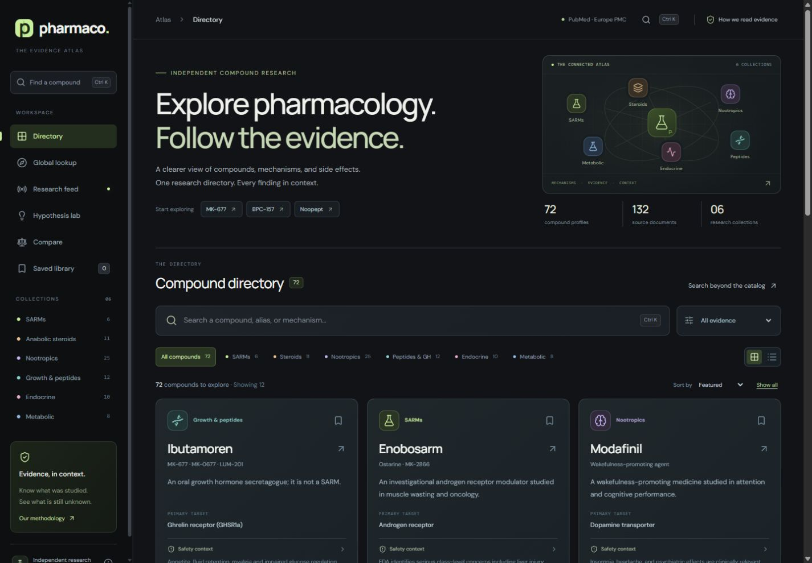

# PharmaNet

### Explore pharmacology. Follow the evidence.

An evidence-first pharmacology atlas that brings compound mechanisms, study findings, adverse effects, and unanswered questions into one research workspace.

Browse **72 curated compounds** across **six collections**, backed by **132 distinct source documents**, then explore live literature, product labels, and chemical identities.



## What you can do

| Feature | What it provides |
| --- | --- |
| Compound directory | SARMs, anabolic steroids, nootropics, growth-related compounds and peptides, endocrine agents, and metabolic compounds. |
| Search and filters | Search names, aliases such as `mk677`, mechanisms, collections, and evidence categories. |
| Safety profiles | Source-linked adverse effects with study populations, reported measures where available, interaction context, and explicit unknowns. |
| Live research | PubMed-indexed studies retrieved through Europe PMC, with study-type filters, pagination, and refresh. |
| Prescribing information | Product-specific US label records from openFDA, linked to the source label. |
| Global lookup | PubChem autocomplete and identity records beyond the curated catalog. |
| Comparisons and bookmarks | Compare up to three compounds and keep a personal saved library in your browser. |
| Hypothesis lab | Source-linked, testable interpretations that distinguish observations from proposed explanations. |

The interface includes responsive layouts, keyboard navigation, shareable profile links, and grid/list preferences.

## Run locally

**Requirements:** Node.js 22 LTS and npm.

```sh
git clone https://github.com/MagicMuffinBoi/pharmanet.git
cd pharmanet
npm ci
npm run dev
```

Open **http://localhost:3000**. No database or API keys are required. Live research, labels, identity lookup, and Google Fonts need an internet connection; the curated catalog is included in the source.

| Command | Purpose |
| --- | --- |
| `npm run dev` | Start the development server. |
| `npm run build` | Create a production build and run Next.js type checks. |
| `npm start` | Serve the production build. |
| `npm run typecheck` | Run TypeScript checking independently. |

## Deploy to Vercel

Import **MagicMuffinBoi/pharmanet** as a Vercel project using these settings:

| Setting | Value |
| --- | --- |
| Framework | Next.js |
| Root Directory | Repository root |
| Node.js | 22.x |
| Install Command | `npm ci` |
| Build Command | `npm run build` |
| Output Directory | Framework default |
| Production Branch | `main` |

Once Git integration is connected, pushes to `main` trigger production deployments; other branches can receive preview deployments. See [Vercel's Git deployment guide](https://vercel.com/docs/git).

No environment variables are required. Optionally set `NEXT_PUBLIC_SITE_URL` to a custom domain, including `https://`, and redeploy. Otherwise metadata uses Vercel's production URL. See [.env.example](.env.example).

## How to read the evidence

The curated catalog is an editorial snapshot prepared **6 November 2026**, rather than an exhaustive inventory of all pharmaceuticals. Each profile separates mechanism, study findings, limitations, pharmacokinetics, adverse effects, and interaction context.

- **Evidence labels describe the available research.** They are not proof of benefit or safety.
- **Population and exposure matter.** Findings in patients, older adults, animals, or cell models may not apply to healthy users.
- **Unknown frequency does not mean zero risk.** Case reports cannot establish incidence, and animal findings do not supply human event rates.
- **Identity is not a safety review.** Global PubChem matches are unreviewed records and do not become curated profiles automatically.
- **Hypotheses remain hypotheses.** The project does not claim that proposed explanations are established findings or verified scientific firsts.

This project is an educational research reference. It does not provide prescribing decisions, dosing plans, or individualized medical advice.

### Freshness and availability

Curated summaries do not automatically rewrite themselves when new studies appear. The live literature feed refreshes while visible and supports manual refresh, with server results cached for up to ten minutes. PubChem identities and openFDA labels are cached for up to one hour per running instance. Serverless instances do not share that in-memory cache.

Upstream indexing delays, outages, rate limits, and incomplete records can affect live results. The interface displays retrieval context and service errors. [VERIFICATION.md](VERIFICATION.md) records the migration checks and their limits.

## Project structure

```text
app/
  Directory.tsx          Directory, profiles, comparisons, bookmarks, research feed
  EvidenceViews.tsx      Safety details, labels, global lookup, hypothesis views
  atlas.css              Responsive visual system
  api/
    research/route.ts    Europe PMC literature search
    labels/route.ts      openFDA label retrieval
    discover/route.ts    PubChem autocomplete and identity lookup
lib/
  directory.ts          Types, original profiles, references, research queries
  *-data.json           Expanded profiles and references
  legacy-safety.json    Structured safety data for original profiles
public/
  favicon.svg
```

Built with **Next.js 16**, **React 19**, **TypeScript**, plain CSS, and **Lucide** icons.

## Data sources and attribution

- [Europe PMC REST API](https://europepmc.org/RestfulWebService) — PubMed-indexed literature metadata.
- [PubChem PUG REST](https://pubchem.ncbi.nlm.nih.gov/docs/pug-rest) — compound identities and properties.
- [openFDA drug labels](https://open.fda.gov/apis/drug/label/) — US product-label records.
- [DailyMed](https://dailymed.nlm.nih.gov/) and the primary records linked within profiles — source context and label verification.
- [Google Fonts](https://fonts.google.com/) — DM Sans and Manrope.

Source papers are linked rather than bundled. Third-party content and dependencies retain their respective terms and licenses. No open-source license has been assigned to the original application code.

## State, privacy, and maintenance

Bookmarks and display preferences use browser `localStorage`; they do not sync across devices. The app has no user accounts or server-side user database. Research queries are sent to its API routes and the relevant external data provider. Hosting access controls are configured separately in Vercel.

To update a profile, verify its primary sources, corrections, retractions, population, exposure, and outcomes; attach references to individual safety claims; and revise its uncertainty statements. Report content issues with the compound name, the claim in question, and the supporting primary source.
